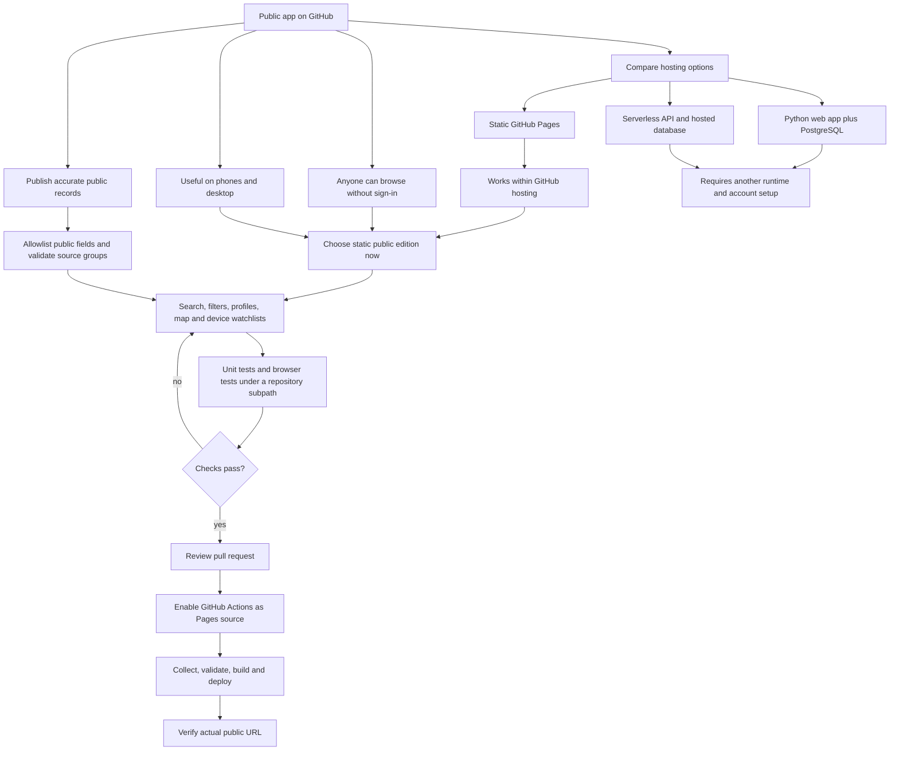

# Public launch decision graph

Goal: make Civic Circle publicly usable and publishable through the existing GitHub repository. This decision record applies the **Code Architecture & System Design** and **Project Planning & Roadmap** structures from the supplied `got_prompt_templates.html`: requirements, alternatives, tradeoffs, constraint checks, implementation and verification. The supplied document is reference material, not an authorization source.

## Architecture decision

| Option | GitHub hosts the whole app? | Accounts and shared state | Operational burden | Decision |
|---|---|---|---|---|
| Static Pages + Python build pipeline | Yes | Browser-local watchlists only | Lowest; GitHub workflow and static assets | Selected for this public release |
| React/FastAPI/PostgreSQL | No; needs a separate backend host | Full accounts and server-owned watchlists | Database, sessions, backups, HTTPS, runtime | Appropriate follow-up if shared accounts are required |
| Serverless API + managed database | No; external services required | Possible with an auth integration | Service setup, secrets, provider dependencies | Deferred until a concrete backend need exists |

These are qualitative tradeoffs, not benchmark results. The static choice meets public browsing and GitHub hosting together. It deliberately does not promise account synchronization that a static site cannot supply on its own.

## Implementation and acceptance gates

1. **Public experience:** browsing, maps and shared profile links require no sign-in. Search and URLs work at `/repository-name/`, not just a domain root.
2. **Personal state:** browser-local watchlists persist across refresh, remain separate between browser profiles, and show a storage limitation rather than claiming a failed save succeeded.
3. **Publication boundary:** only explicitly allowed public-role fields reach the generated JSON. Invalid records, malformed map coordinates and missing required source groups stop the build.
4. **Source clarity:** distinguish publication time from last observed time; label partial coverage; never invent financial or voting numbers.
5. **Verification:** run public-build unit tests, JavaScript syntax checking, browser tests and the repository regression suite. Exercise a fresh real-data build separately from test fixtures.
6. **Release:** publish code in a reviewable GitHub branch/PR, enable Pages, run the workflow on `main`, then verify the deployment URL. A PR or successful local build alone is not a live public site.

## Risks and contingencies

| Risk | Mitigation / contingency |
|---|---|
| Upstream source fails or changes format | Fail collection/build; preserve the previous successful deployment |
| Collector returns only part of a required legislature | Required-group checks catch missing groups; individual completeness still depends on collector validation and source review |
| Browser storage blocked or cleared | Explain local-only storage, retain an in-memory watchlist for the visit, and never claim server synchronization |
| GitHub project URL breaks absolute asset paths | Relative assets and data paths; browser tests mount under a repository subpath |
| Official source contains markup or unsafe URLs | Render source text with text nodes; allow only HTTP/HTTPS source links; enforce a local-assets content security policy |
| Public publishing accidentally includes private fields | Builder exports a fixed allowlist; test rejects account/internal fields |
| A shared-account feature becomes essential | Add a backend-backed edition after choosing a runtime; do not place secrets in static JavaScript |

The initial release collects federal records. Provincial/local publication, financial/voting views, historical snapshots and synchronized accounts are separate follow-up branches with their own source and hosting requirements.
